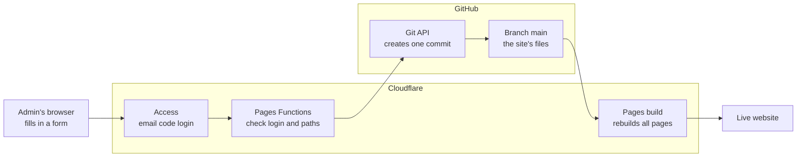

# site-kit

Shared plumbing for small static websites hosted on **Cloudflare Pages** with their code on **GitHub**: a login for
the site's administrators (Cloudflare Access) and a small admin API that saves their changes to the repository as
commits. Each site keeps its own pages and its own admin screens; site-kit is only the part that is the same everywhere.

This repository is public so that Cloudflare's build and other repositories can fetch it. It contains no secrets and
no site content.

## How an admin built on it works

An administrator signs in with a one-time code sent by email; each *Save* becomes **one commit** in the site's GitHub
repository, and the commit makes Cloudflare rebuild the site. Nothing is stored anywhere else: no database.



What a save does, step by step:

1. **The browser** prepares everything: the site's admin pages build the file contents (and shrink photos). Each
   binary file is uploaded on its own first (`POST blob`); GitHub stores it and returns an ID, but it isn't part of
   the site yet. Then one `POST commit` carries a short summary and the list of changes: a path with new text, a
   path with an uploaded file's ID, or a path to delete.
2. **Cloudflare Access** (Zero Trust) sits in front of the admin's path and only lets a request through after the
   email-code sign-in. It attaches a signed proof of who is signed in.
3. **Cloudflare Pages Functions** (this package) check that proof again themselves – signature, audience, expiry –
   never trusting that Access ran, because the same site also answers at addresses Access doesn't cover. A write
   must come from the admin pages themselves (same origin, JSON). Every path is checked against the folders the
   site allows (`writable`); one path outside them refuses the whole save.
4. **GitHub's Git API**, called with `GITHUB_TOKEN`: read the latest commit on the branch, create a new snapshot with
   the changes applied, create a commit on top, move the branch to it. If someone else committed in between, it
   tries once more, then reports an error so the administrator can save again.
5. **The commit** is recorded under the account that owns the token; its message is the summary plus
   "Saved in the website admin by <email>", so the history shows who saved what. Undoing a save is reverting
   that commit.
6. **Cloudflare Pages** is connected to the repository, so a new commit on the branch starts a build – a save in the
   admin and a `git push` are the same to it. When the build succeeds the site switches to the new version; if it
   fails, the previous version stays online and the error is in the Pages *Deployments* list.

Functions on the free plan get 10 ms of processing and 50 outgoing requests per request, which is why the browser
does the preparing and the server only checks and forwards.

## Using it in a site

```bash
npm install https://github.com/frankspeak/site-kit/archive/refs/tags/v0.1.0.tar.gz
```

(The release download, not `github:frankspeak/site-kit#v0.1.0`: npm records that form as an SSH address in the lock
file, which Cloudflare's build can't fetch.)

One file creates the admin from the site's settings and says which files it may touch:

```ts
// functions/_lib/admin.ts
import { createAdmin } from 'site-kit';

export const admin = createAdmin({
  host: 'example.pages.dev',                            // the address behind Cloudflare Access
  accessTeamDomain: 'your-team.cloudflareaccess.com',   // Zero Trust → Settings
  accessAud: '…',                                       // the Access application's "audience" tag (not secret)
  githubRepo: 'owner/repo',
  githubBranch: 'main',
  writable: { 'src/content/events/': /^[^/]+\.md$/ },   // folder → pattern for the rest of the path
  // readable: defaults to `writable`;  path: defaults to '/admin'
});
```

Pages Functions are routed by file name, so each route is a one-line file:

| File | Content |
|---|---|
| `functions/admin/_middleware.ts` | `export const onRequest = admin.guard;` |
| `functions/admin/api/_middleware.ts` | `export const onRequest = admin.apiGuard;` |
| `functions/admin/api/whoami.ts` | `export const onRequestGet = admin.whoami;` |
| `functions/admin/api/tree.ts` | `export const onRequestGet = admin.tree;` |
| `functions/admin/api/file.ts` | `export const onRequestGet = admin.file;` |
| `functions/admin/api/blob.ts` | `export const onRequestPost = admin.blob;` |
| `functions/admin/api/commit.ts` | `export const onRequestPost = admin.commit;` |

The API the site's admin pages then call (all under `/admin/api/`):

| Call | Does |
|---|---|
| `GET whoami` | `{ email }` of the signed-in administrator |
| `GET tree` | the repository's file list (GitHub's format) |
| `GET file?path=…` | raw contents of a readable file |
| `POST blob` `{ content: base64 }` | uploads one binary file, returns `{ sha }` for the next commit |
| `POST commit` `{ message, changes: [{ path, content \| sha \| delete }] }` | saves everything as one commit |

**The one secret:** `GITHUB_TOKEN` in Cloudflare Pages → *Settings → Variables and secrets* – a fine-grained GitHub
token with *Contents: Read and write* on the one repository. Without it, or without a valid login, the admin refuses
everyone (it fails closed) and says what is missing.

## Testing an admin locally

No real token or repository needed. In the site's folder, `.dev.vars` holds:

```
DEV_ADMIN_EMAIL=you@example.com      # skips the login – honoured for localhost only
GITHUB_TOKEN=local-test
GITHUB_API=http://127.0.0.1:8788
```

```bash
npx site-kit-mock-github src/content src/data    # a stand-in for GitHub: serves these folders, records commits in .mock-github/
npx wrangler pages dev dist --port 8789          # the built site with its Functions
```

The working copy is never changed; every "commit" is listed in `.mock-github/commits.log`.

## Layout

```
src/auth.ts        checks the Cloudflare Access login (signature, audience, expiry); the settings type
src/github.ts      GitHub client: file list, file contents, upload, one commit with several changes
src/admin.ts       createAdmin(): the guards and the five API handlers
bin/mock-github.mjs   the stand-in GitHub for local testing
```

`npm run check` type-checks it. The code is TypeScript used as-is (Cloudflare bundles it); there is no build step.

## Releases

Sites pin a release (`v0.1.0`), so a change here reaches a site only when that site moves to a newer tag.
After a change: `npm run check`, test in a site with `npm install ../site-kit`, then tag and push
(`git tag v0.x.0 && git push --tags`).

## Sites using it

- `bavarianspringboks` – club website with an admin for events, photos and newsletters.

## Planned

1. **Access rules per path** – one middleware with three modes (`public`, shared `password`, `access`), so a
   whole-site login like family-tree's uses the same code.
2. **Setup script** – reads a site's settings and makes Cloudflare and GitHub match: Pages project, custom domain,
   DNS records, the Access application (writing its IDs back into the settings), secrets.
3. **GitHub App instead of a personal token** – nothing expires, and no token tied to one person's account.
4. Shared GitHub workflows (daily rebuild, photo conversion).
